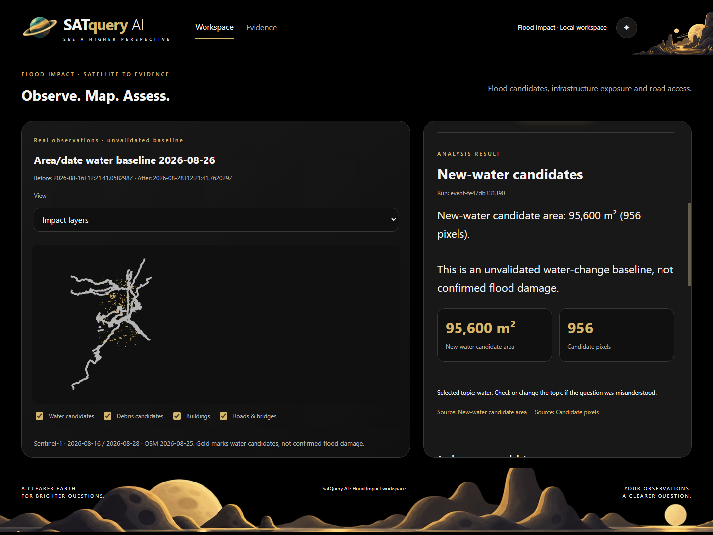

# SatQuery · Flood Lab

### Observe. Map. Assess.

A local workspace for turning before/after satellite observations into **water candidates, infrastructure exposure and inspectable evidence**. Built for remote-sensing researchers and analysts reviewing possible flood impacts.

**Status:** working research prototype with saved Nepal cases. Flood/debris accuracy and real settlement isolation remain unvalidated. Outputs guide review; they do not establish damage or safe travel.

[See the walkthrough](docs/guides/REVIEWER_WALKTHROUGH.md) · [Run locally](docs/guides/GETTING_STARTED.md) · [Read the evidence](docs/guides/EVIDENCE.md) · [Architecture](docs/guides/ARCHITECTURE.md)



*Actual application, captured locally on 27 October 2026 using frozen Syapru run `event-fe47db331390`. Gold marks candidates; intersections indicate possible exposure. The answer uses an explicitly selected topic and saved calculations. [Screenshot provenance](docs/images/README.md).*

## From imagery to an answer you can inspect

Flood review needs more than a water mask: observations must be comparable, infrastructure must predate the event, and reported numbers must point back to calculations.

1. **Choose an area and date** or open a frozen analysis.
2. **Check observations.** Compare Sentinel-1 dates, inspect available Sentinel-2 RGB previews, and retain invalid coverage as unknown.
3. **Map candidates and exposure.** Apply the fixed SAR-change baseline, intersect historical buildings/roads/bridges, and assess access only where graph inputs permit it.
4. **Inspect and export.** Ask about saved results, follow the processing record, and download masks, feature tables, reports and SHA-256 manifests.

The workspace runs at **http://localhost:8770/**, separately from the original SatQuery application.

## Review it in one minute

Follow the [saved-run walkthrough](docs/guides/REVIEWER_WALKTHROUGH.md): map → optical observations → saved answer → processing record → evidence limits.

Without installing, open the [situation report](output/pdf/nepal-situation-report.pdf), [technical report](output/pdf/technical-report.pdf) or [full evidence report](output/pdf/flood-impact-final-report.pdf). These historical deliverables are preserved as generated. The [evidence guide](docs/guides/EVIDENCE.md) explains scope and later verification.

**Fresh-clone expectation:** source, screenshots, preview imagery, test records and PDFs are included. Acquired rasters, historical OSM payloads and frozen run folders are excluded. The screenshot's saved event will not appear in a fresh clone. Use the [offline synthetic example](docs/guides/GETTING_STARTED.md#offline-example) to exercise calculations and exports without accounts.

## What works today

| Capability | Current boundary |
| --- | --- |
| Area/date acquisition | Bounded provider-backed SAR, historical OSM, topology and optical/debris workflow. Requires API access and coverage. |
| Water-change mapping | Fixed VV threshold and change rule; no trained flood model or event calibration. |
| Infrastructure exposure | Geometry intersections with source IDs and valid coverage. Exposure is not damage. |
| Road-access comparison | Synthetic graph cases tested. Real Nepal access remains unknown where hubs, coverage or snapping are unresolved. |
| Optical views and debris | Dated RGB previews where registered; vegetation-loss/SAR-change proxy remains unvalidated. |
| English/Nepali answers | Saved values rendered by topic. Optional Qwen3-0.6B selects topics; explicit selection works without it. Nepali needs review. |
| Exports | GeoTIFF, GeoJSON, CSV, English/Nepali HTML, provenance, sensitivity and frozen hashes. |

The offline fixture uses invented rasters and geometry. Independent accuracy validation, direct debris labels, verified real access and broader operational evaluation remain open. [Methods and limits](docs/guides/ARCHITECTURE.md#methods-and-limits).

## Evidence at a glance

| Measurement | Result | Scope and source |
| --- | --- | --- |
| Software regression | **70 passed**, 31 warnings | Fresh check on 27 Oct 2026 in the existing Python 3.11 environment; [verification](docs/presentation/VERIFICATION.md). No accuracy claim. |
| Full area/date runtime | **51.6 s mean**, 35.5–81.8 s | Five historical successes: four Syapru rectangles and one Timure request. [Dated record](docs/closure-checks.md). Small repeated sample. |
| Water-reference agreement | **IoU 1.34%**, recall 1.37% | Two AOIs, 57,446 valid pixels. Poor agreement against preliminary **mixed-impact** UNOSAT mapping, not water-only truth. [Details](docs/guides/EVIDENCE.md#reference-comparisons). |

No measured cost savings, field outcomes or production-readiness claim is made. Poor reference agreement remains a limitation to investigate.

## Start and explore

For an existing configured WSL installation, open PowerShell in this repository:

```powershell
.\start-demo.ps1
```

The launcher expects existing Python environments; it does not install them. New clones should follow [Python setup, the offline example and API access](docs/guides/GETTING_STARTED.md). The dependency record needs the documented `pyarrow` supplement. Optional AI has a separate CUDA/model setup.

| Looking for… | Go here |
| --- | --- |
| Setup and troubleshooting | [Getting started](docs/guides/GETTING_STARTED.md) |
| Strongest saved example and click sequence | [Reviewer walkthrough](docs/guides/REVIEWER_WALKTHROUGH.md) |
| Data flow, methods, code and outputs | [Architecture](docs/guides/ARCHITECTURE.md) |
| Benchmarks, source roles and open work | [Evidence guide](docs/guides/EVIDENCE.md) |
| Presentation checks and fresh regression | [Verification](docs/presentation/VERIFICATION.md) |
| Reports and narration | [Full PDF](output/pdf/flood-impact-final-report.pdf) · [90-second script](docs/demo-script.md) |
| Competition scope and inheritance | [Dated specification audit](docs/official-spec-audit.md) · [Reuse audit](docs/reuse-audit.md) |

## Sources and attribution

Contains modified Copernicus Sentinel data 2026. [Sentinel data notice](https://sentinels.copernicus.eu/documents/247904/690755/Sentinel_Data_Legal_Notice). Other inputs: Copernicus DEM; [© OpenStreetMap contributors](https://www.openstreetmap.org/copyright), historical extraction via HeiGIT/ohsome; EMSR927 and UNOSAT products for evaluation only. Qwen3-0.6B provides optional topic routing.

See [source roles and links](docs/guides/EVIDENCE.md#data-sources), the [existing MIT software license](LICENSE) and [upstream notices](vendor/SATQUERY-LICENSE.txt). Data and model terms apply separately. No hosted demo or competition submission is claimed.
