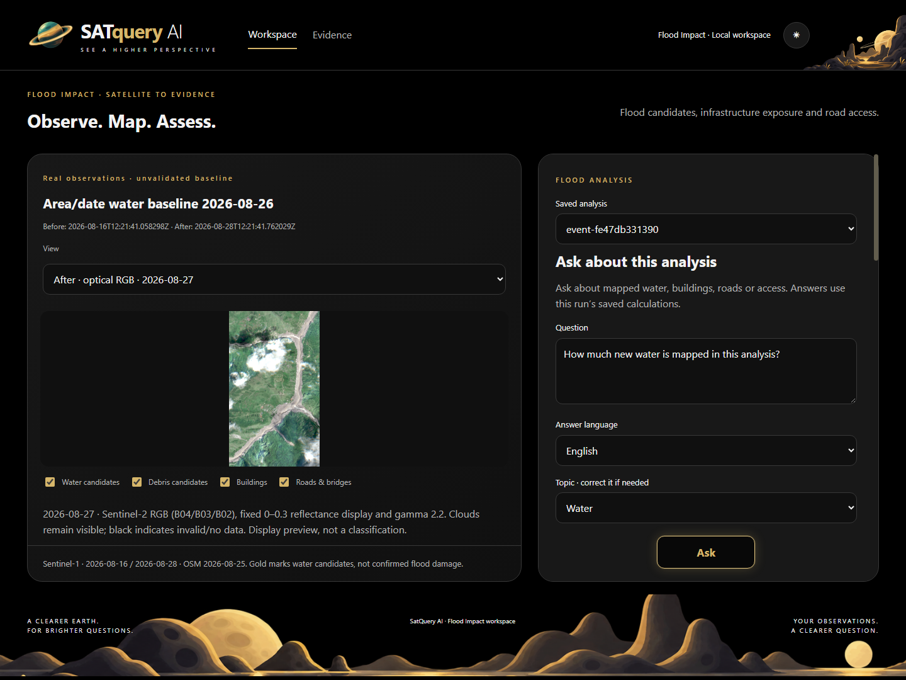

# A one-minute reviewer walkthrough

[Home](../../README.md) · [Setup](GETTING_STARTED.md) · [Evidence](EVIDENCE.md)

**Strongest existing example:** `event-fe47db331390`, a saved Syapru area/date run for 26 August 2026. Its screenshots and verification summary are versioned; its frozen payload remains local. A new clone needs its own inputs. The [offline fixture](GETTING_STARTED.md#offline-example) exercises the calculation/export flow with invented data.

## Inspect without installing

| Time | Inspect | What it establishes |
| --- | --- | --- |
| 0–15 s | Map and saved answer below | Candidate layers and a value tied to a named run. |
| 15–30 s | [Optical screen](../images/optical.png) and [source dates](../images/README.md) | Registered imagery with cloud/invalid coverage visible. |
| 30–45 s | [Workflow record](../full-workflow-verification.json) | Saved counts and 15 checked downloads. |
| 45–60 s | [Evidence table](EVIDENCE.md#reference-comparisons) | Poor external agreement, class mismatch and unresolved access are explicit. |

## Click through a configured workspace

1. Select **Workspace** → **Saved analysis** → `event-fe47db331390`.
2. In **View**, compare **Before · SAR VV** and **After · SAR VV** (16/28 Aug 2026). Inspect available **optical RGB** previews. Click an image to expand; wheel or +/− zooms, Esc closes.
3. Return to **Impact layers**. Toggle water, debris, buildings and roads/bridges; hover a feature for its source ID.
4. Enter “How much new water is mapped in this analysis?”, select topic **Water**, then **Ask**. This uses saved calculations without AI inference. Expected answer: **95,600 m² / 956 candidate pixels**.
5. Inspect **Processing record** and expand **Evidence & downloads**. Trace the answer through `result.json`, `prediction.tif`, `exposure.csv` and `freeze.json`.
6. Expand **Settlement access** and **Assumptions & limitations**. Access remains unresolved. Open **Evidence** for software checks; its overview is historical, not a live scientific benchmark ledger.

## Interpret the example

The [saved summary](../full-workflow-verification.json) has **99,858 valid paired pixels / 110,998 grid pixels**, 956 new-water candidates, two intersected buildings / 522 mapped buildings, **185.846 m** of intersected road/bridge length and two bridge features. These are calculations on observed coverage, not confirmed damage. The debris proxy is a separate class; do not sum it with water as a validated impact total.

`connectivity_assessed: false` takes precedence over `potentially_cut_off: 0`: access is **unknown**.

Optical previews are registered display assets. [Dates and grid-match caveats](../images/README.md) differ from the optical inputs in the debris processing record; this is not a like-for-like flood-validation comparison.

## Deliverables

- [Situation report](../../output/pdf/nepal-situation-report.pdf).
- [Technical report](../../output/pdf/technical-report.pdf).
- [Full historical evidence report](../../output/pdf/flood-impact-final-report.pdf).
- [90-second narration/click cues](../demo-script.md). A script is included; a recording is not.
- [Evidence boundaries and sources](EVIDENCE.md).
